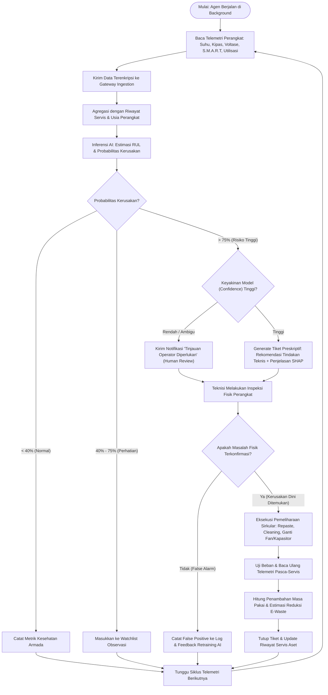
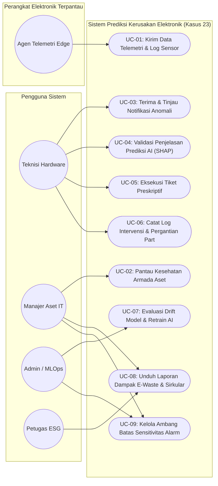
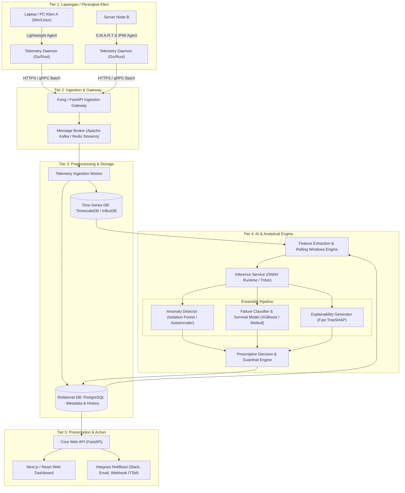
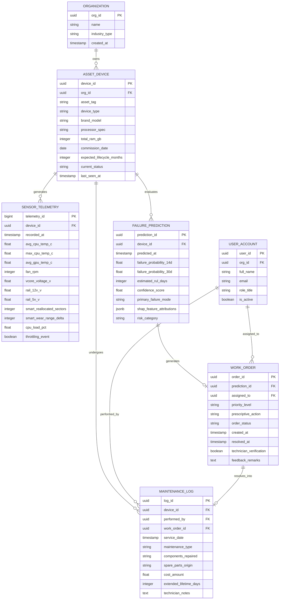

# RANCANGAN SISTEM PREDIKSI KERUSAKAN PERANGKAT ELEKTRONIK BERBASIS AI
## Dokumen Baseline Arsitektur, Pemodelan Sistem, dan Rekayasa Solusi
**Studi Kasus No. 23: AI-Based Electronic Failure Prediction**  
**Mata Kuliah: Green Computing & Sustainable AI (Pertemuan 10)**  
**Fokus: Circular Economy • Pengelolaan Limbah Elektronik • Machine Learning & Telemetri**

---

## 1. Identifikasi Masalah

### 1.1 Latar Belakang
Dalam paradigma industri teknologi konvensional yang berbasis ekonomi linier (*take-make-dispose*), perangkat keras elektronik organisasi (seperti server, workstation, desktop, laptop korporat, dan perangkat jaringan) kerap diperlakukan dengan dua pendekatan ekstrem yang merugikan:
1. **Run-to-Failure (Reaktif):** Perangkat dioperasikan secara terus-menerus hingga terjadi kerusakan fatal (*catastrophic failure*). Pendekatan ini sering kali mengakibatkan kerusakan merambat (*secondary collateral damage*)—contohnya, kipas pendingin yang macet menyebabkan panas ekstrem yang membakar sirkuit regulator daya (VRM) atau *motherboard*, sehingga perangkat tidak dapat diperbaiki lagi (*unrepairable*) dan terpaksa dibuang sebagai *e-waste*.
2. **Scheduled / Age-Based Replacement (Preventif Kaku):** Organisasi mengganti armada perangkat secara massal hanya berdasarkan batas usia buku akuntansi (misalnya siklus 3 atau 4 tahun), tanpa memedulikan kondisi kesehatan fisik aktual perangkat (*actual device health*). Hal ini menimbulkan *premature obsolescence*, membuang perangkat yang sebenarnya masih memiliki sisa usia pakai (*remaining useful life*) yang panjang.

Akumulasi perangkat yang rusak sebelum waktunya menyumbang peningkatan volume limbah elektronik (*e-waste*) global secara signifikan. Limbah elektronik mengandung logam berat berbahaya (timbal, merkuri, kadmium) serta material berharga (emas, tembaga, unsur tanah jarang) yang membutuhkan emisi energi raksasa pada tahap ekstraksi bijih primer (*embodied carbon*).

### 1.2 Rumusan Masalah
Berdasarkan kondisi di atas, rumusan masalah teknis yang dihadapi adalah:
1. Bagaimana mengidentifikasi tanda-tanda degradasi fisik dan operasional perangkat elektronik sebelum terjadi kerusakan fatal yang tidak dapat dipulihkan?
2. Bagaimana memodelkan estimasi Sisa Masa Pakai (*Remaining Useful Life* - RUL) secara akurat dengan mengintegrasikan data telemetri operasional, data riwayat pemeliharaan, serta usia kronologis perangkat?
3. Bagaimana mengonversi prediksi kegagalan menjadi rekomendasi tindakan pemeliharaan preskriptif (*prescriptive maintenance*) guna mendukung prinsip perpanjangan masa pakai dalam kerangka ekonomi sirkular?
4. Bagaimana memastikan sistem prediktif mematuhi prinsip *Responsible AI* dan *Green Computing*, di mana beban komputasi AI tidak menimbulkan jejak karbon berlebih dan keputusan kritis tidak dieksekusi secara buta (*blind automation*) tanpa verifikasi teknisi manusia?

### 1.3 Batasan Masalah & Lingkup Kajian
* **Jenis Aset yang Dicakup:** Komputer desktop korporat, laptop, server unit mikro/kantor, dan perangkat komputasi tepi (*edge nodes*).
* **Komponen Kritis yang Dipantau:**
  * Sub-sistem Termal: Fan bearing, sinkronisasi PWM fan vs temperatur die, efisiensi pelepasan panas *thermal interface material* (TIM/thermal paste).
  * Sub-sistem Penyimpanan: Hard Disk Drive (HDD) dan Solid State Drive (SSD) berbasis atribut S.M.A.R.T (*wear leveling count*, *bad sectors*, *temperature history*).
  * Sub-sistem Daya & Sirkuit: Degradasi kapasitor elektrolit/VRM, fluktuasi voltase rel (12V, 5V, 3.3V), *power-on cycles*, dan *duty-cycle strain*.
  * Sub-sistem Pemrosesan: Stres komputasi CPU/GPU dan frekuensi *throttling*.
* **Lingkup Solusi:** Sistem perangkat lunak mencakup agen pengumpul telemetri (*telemetry agent*), jalur *data pipeline*, mesin inferensi AI berbasis *predictive maintenance*, antarmuka manajemen armada IT (*fleet dashboard*), dan modul rekomendasi intervensi sirkular.

---

## 2. Analisis Kebutuhan Sistem

### 2.1 Kebutuhan Fungsional (Functional Requirements)
* **FR-01 (Automated Telemetry Ingestion):** Sistem harus mampu mengumpulkan data operasional periodik (temperatur, voltase, kecepatan kipas, metrik S.M.A.R.T, utilisasi komputasi) dari agen perangkat klien tanpa membebani performa kerja pengguna.
* **FR-02 (Historical Maintenance Integration):** Sistem harus mencatat dan mengaitkan log riwayat servis (penggantian komponen, pembersihan debu, penggantian pasta termal, instalasi ulang OS) ke dalam profil siklus hidup perangkat.
* **FR-03 (Anomaly & Degradation Detection):** Sistem harus mampu mendeteksi deviasi perilaku operasional komponen terhadap kondisi dasar (*baseline*) komponen yang sehat.
* **FR-04 (Remaining Useful Life & Failure Risk Scoring):** Sistem harus menghitung probabilitas kegagalan dalam rentang waktu tertentu (7 hari, 30 hari, 90 hari) dan mengestimasi nilai RUL dalam satuan hari/jam operasional.
* **FR-05 (Prescriptive Action Recommendation):** Sistem harus menghasilkan rekomendasi tindakan teknis spesifik (contoh: "Lakukan penggantian pasta termal dan pembersihan sirip pendingin", "Migrasikan data karena SSD cadangan blok tersisa di bawah 5%", "Turunkan profil daya/workload").
* **FR-06 (Human-in-the-Loop Validation):** Sistem harus menyediakan mekanisme konfirmasi bagi teknisi untuk memverifikasi atau menolak diagnosis AI sebelum perintah kerja (*work order*) eksekusi diterbitkan.
* **FR-07 (Circular Asset Lifecycle Tracking):** Sistem harus memperbarui status aset pasca-intervensi pemeliharaan guna mencatat perpanjangan masa pakai yang berhasil dicapai (menghitung tambahan hari operasional).
* **FR-08 (Sustainability & Carbon Avoidance Reporting):** Sistem harus menghitung metrik dampak lingkungan berupa estimasi kilogram *e-waste* yang berhasil dicegah dan kilogram emisi karbon (*Scope 3 embodied carbon*) yang berhasil ditunda/dihindari.

### 2.2 Kebutuhan Non-Fungsional (Non-Functional Requirements)
* **NFR-01 (Akurasi Prediksi & False Alarm Rate):** Model AI harus memiliki nilai *Recall* $\ge 88\%$ untuk deteksi potensi kegagalan fatal dalam jendela 14 hari, dengan tingkat *False Positive Rate* (FPR) $< 5\%$ untuk mencegah timbulnya *alarm fatigue* pada teknisi.
* **NFR-02 (Green Computing & Lightweight Resource Footprint):** Agen telemetri di sisi klien tidak boleh mengonsumsi utilisasi CPU $> 1.5\%$ dan memori RAM $> 50$ MB. Pemrosesan inferensi AI di server harus mengutamakan model tabular/deret waktu yang efisien (seperti LightGBM/XGBoost dan compact TCN) dibandingkan arsitektur deep transformer berukuran gigantis, guna meminimalkan konsumsi energi server.
* **NFR-03 (Latency & Throughput):** Inferensi batch reguler armada perangkat (skala 5.000 unit) harus diselesaikan dalam waktu kurang dari 15 menit per siklus pemindaian (dijalankan tiap 6 atau 12 jam).
* **NFR-04 (Data Privacy & Zero Surveillance):** Sistem dilarang merekam data konten pengguna, riwayat penjelajahan, penekanan tombol (*keystroke*), atau tangkapan layar. Agen hanya boleh membaca sensor perangkat keras tingkat rendah (*low-level hardware counters/sensors*).
* **NFR-05 (Explainability & Interpretability):** Setiap skor risiko tinggi yang dikeluarkan AI wajib disertai penjelasan atribut penyebab utama (*feature attribution*, misal menggunakan SHAP values) sehingga teknisi memahami rasionalisasi di balik prediksi kerusakan tersebut.
* **NFR-06 (Reliability & Fail-Safe):** Jika agen telemetri kehilangan koneksi jaringan, data telemetri harus di-buffer secara lokal hingga 72 jam dan diunggah ulang secara bertahap begitu koneksi pulih (*store-and-forward*).

---

## 3. Identifikasi Pengguna & Peran (Actor & User Roles)

### 3.1 Profil Aktor
1. **Teknisi Hardware IT (Field / Service Technician):**
   * *Tanggung Jawab:* Menerima notifikasi anomali, melakukan inspeksi fisik terhadap perangkat yang ditandai, melakukan perbaikan/servis komponen (re-pasting, cleaning, fan replacement, swap capacitor), serta menginput hasil validasi faktual ke sistem.
2. **Manajer Aset IT & Fasilitas (IT Asset & Operations Manager):**
   * *Tanggung Jawab:* Memantau peta kesehatan seluruh armada perangkat, menyetujui anggaran penggantian suku cadang bekas/baru, menjadwalkan rotasi beban kerja aset, dan mengevaluasi efektivitas perpanjangan masa pakai perangkat.
3. **Administrator Sistem & AI Engineer (SysAdmin / MLOps):**
   * *Tanggung Jawab:* Memastikan agen telemetri berjalan stabil, mengelola ketersediaan database, memantau *model drift*, mengevaluasi performa model, dan melakukan *retraining* periodik.
4. **Petugas Keberlanjutan Korporat (Chief Sustainability Officer / ESG Officer):**
   * *Tanggung Jawab:* Meninjau metrik kuantitatif dampak lingkungan (reduksi e-waste dan penghematan emisi karbon terwujud) untuk pelaporan kepatuhan ESG (*Environmental, Social, and Governance*).

### 3.2 Matriks Hak Akses dan Tanggung Jawab (RACI)

| Komponen / Aktivitas | Teknisi Hardware | Manajer Aset IT | Admin / MLOps | Petugas ESG |
| :--- | :---: | :---: | :---: | :---: |
| Konfigurasi Agen Telemetri | I | C | R / A | I |
| Pemantauan Dashboard Armada | C | A | R | I |
| Peninjauan Rekomendasi AI & Validasi | R / A | C | I | I |
| Eksekusi Pemeliharaan Fisik | R | A | I | I |
| Input Log Perawatan Pasca Servis | R / A | I | I | I |
| Audit Model Drift & Retraining | I | I | R / A | I |
| Laporan Pengurangan E-Waste & Emisi | I | C | I | R / A |

*(Keterangan: R = Responsible, A = Accountable, C = Consulted, I = Informed)*

---

## 4. Perancangan Proses Bisnis

### 4.1 Deskripsi Alur Kerja End-to-End
1. **Fase Koleksi & Preprocessing:** Agen perangkat membaca sensor metrik termal, voltase, kipas, disk S.M.A.R.T, dan beban kerja harian. Data dikompresi dan dikirimkan ke server melalui enkripsi TLS.
2. **Fase Inferensi & Skoring:** Server menggabungkan data telemetri terkini dengan riwayat usia dan log perawatan masa lalu. Model AI menghitung skor anomali, probabilitas kegagalan, dan estimasi RUL.
3. **Fase Filter Keyakinan & Guardrail (Responsible AI):**
   * Jika probabilitas kegagalan $< 40\%$: Perangkat berstatus *Normal/Sehat*.
   * Jika probabilitas kegagalan antara $40\% - 75\%$ atau ketidakpastian model (*uncertainty interval*) lebar: Sistem menandai untuk *Pemeriksaan Terjadwal / Observasi* tanpa intervensi darurat.
   * Jika probabilitas kegagalan $> 75\%$ dengan tingkat keyakinan tinggi: Sistem otomatis membuat tiket insiden preskriptif.
4. **Fase Human-in-the-Loop:** Teknisi hardware menerima tiket, memeriksa rincian visual kontribusi fitur (SHAP value), dan melakukan inspeksi fisik langsung.
5. **Fase Tindakan & Perpanjangan Siklus Hidup:** Teknisi mengeksekusi perbaikan (misal: membersihkan debu tebal pada heatsink dan mengganti pasta termal). Teknisi mencatat tindakan pada sistem.
6. **Fase Validasi Pasca-Servis & Feedback Loop:** Sensor membaca parameter operasional setelah perbaikan (misal suhu turun kembali ke tingkat normal). Sistem memperbarui kalkulasi perpanjangan masa pakai dan menyimpan data kasus untuk kalibrasi model masa depan.

### 4.2 Diagram Alir Proses Bisnis (Flowchart)



---

## 5. Pemodelan Sistem (System Modeling)

### 5.1 Use Case Diagram



### 5.2 Rincian Spesifikasi Use Case Kunci

#### Use Case: UC-04 (Validasi Penjelasan Prediksi AI & Tindakan Preskriptif)
* **Aktor Utama:** Teknisi Hardware IT
* **Kondisi Awal (Pre-condition):** Sistem telah mendeteksi anomali pada perangkat tertentu dengan skor risiko $> 75\%$ dan tiket preskriptif telah diterbitkan.
* **Alur Utama (Main Flow):**
  1. Teknisi membuka detail tiket insiden perangkat pada antarmuka web.
  2. Sistem menampilkan grafik degradasi historis, estimasi RUL (misal: "Prediksi kegagalan dalam $12 \pm 3$ hari operasional"), dan grafik batang kontribusi fitur (SHAP values).
  3. Sistem menampilkan rekomendasi preskriptif: "Suhu die meningkat $18^\circ\text{C}$ di atas baseline pada beban kerja yang sama; RPM kipas konstan; kemungkinan besar *dry thermal paste* atau penyumbatan debu sirip pendingin."
  4. Teknisi melakukan verifikasi fisik menggunakan termometer inframerah dan inspeksi visual.
  5. Teknisi mengklik tombol "Konfirmasi Temuan" pada antarmuka.
* **Kondisi Akhir (Post-condition):** Tiket berpindah ke status "In Progress (Maintenance)" dan jadwal intervensi dicatat pada kalender aset.

---

## 6. Arsitektur Solusi & Alur Pemrosesan AI

### 6.1 Arsitektur Aplikasi Multi-Tier

Sistem dirancang dengan arsitektur berlapis yang memisahkan beban pengumpulan data, pengolahan *pipeline*, inferensi cerdas, serta lapisan penyajian:



### 6.2 Prinsip Green AI dalam Perancangan Sistem
Untuk mencegah ironi di mana komputasi AI justru menghabiskan energi lebih banyak daripada energi perangkat yang diselamatkannya, sistem menerapkan kaidah *Green Computing*:
1. **Edge Sampling & Local Thresholding:** Agen di sisi perangkat hanya mengirimkan ringkasan agregat (rata-rata 15 menit, nilai puncak, deviasi standar) saat kondisi normal. Data mentah resolusi tinggi per detik hanya dikirimkan bila sensor mendeteksi lonjakan di luar batas toleransi lokal.
2. **Model Ringan (Lightweight Tabular Models):** Alih-alih melatih model deep neural network yang lapar daya (seperti transformer masif), sistem menggunakan model *Gradient Boosted Decision Trees* (LightGBM/XGBoost) yang telah dikompilasi ke format ONNX. Inferensi 1.000 perangkat hanya membutuhkan beberapa ratus milidetik dan konsumsi daya komputasi minimal.
3. **Batch Scheduling:** Inferensi prediksi kegagalan armada dilakukan secara *batch* pada malam hari atau waktu di mana jaringan listrik memiliki jejak karbon terendah (*carbon-aware workload scheduling*).

---

## 7. Perancangan Basis Data (Database Architecture)

### 7.1 Entity-Relationship Diagram (ERD)



### 7.2 Spesifikasi Kamus Data Utama

#### 1. Tabel `ASSET_DEVICE`
* Menyimpan informasi statis dan spesifikasi teknis perangkat.
* Kolom kunci: `device_id` (UUID, PK), `asset_tag` (VARCHAR, unik), `commission_date` (DATE, tanggal pertama kali dioperasikan), `expected_lifecycle_months` (INT, target usia normal pabrikan), `current_status` (ENUM: `ACTIVE`, `DEGRADED`, `MAINTENANCE`, `RETIRED_CIRCULAR`, `RECYCLED`).

#### 2. Tabel `SENSOR_TELEMETRY` (Partisi Waktu / Hypertable di TimescaleDB)
* Menyimpan log telemetri agregat per interval 15 menit.
* Kolom kunci: `telemetry_id` (BIGINT, PK), `device_id` (UUID, FK), `recorded_at` (TIMESTAMPTZ), `avg_cpu_temp_c` (FLOAT), `fan_rpm` (INT), `smart_reallocated_sectors` (INT), `throttling_event` (BOOLEAN).

#### 3. Tabel `FAILURE_PREDICTION`
* Menyimpan riwayat hasil skor inferensi AI.
* Kolom kunci: `prediction_id` (UUID, PK), `device_id` (UUID, FK), `predicted_at` (TIMESTAMPTZ), `estimated_rul_days` (INT, estimasi sisa hari operasional), `confidence_score` (FLOAT, $0.0 - 1.0$), `primary_failure_mode` (VARCHAR: misal `THERMAL_EXHAUSTION`, `STORAGE_BAD_BLOCKS`, `VOLTAGE_UNSTABILITY`), `shap_feature_attributions` (JSONB, memuat bobot variabel pemicu anomali).

#### 4. Tabel `WORK_ORDER`
* Menyimpan tiket instruksi kerja preskriptif yang terhubung langsung dengan keputusan teknisi.
* Kolom kunci: `order_id` (UUID, PK), `prediction_id` (UUID, FK), `technician_verification` (BOOLEAN: `TRUE` jika kerusakan terbukti nyata, `FALSE` jika false positive), `prescriptive_action` (TEXT: tindakan rekomendasi seperti "Re-paste heatsink, bersihkan sirip kipas, periksa bearing kipas CPU").

---

## 8. Desain Antarmuka Pengguna (UI/UX Prototype Specification)

Antarmuka dirancang dengan pendekatan *Information-Dense, Low-Cognitive Load* yang mengutamakan visualisasi status armada serta transparansi bukti prediksi AI.

### 8.1 Wireframe Layout 1: Executive Fleet Health & Circular Impact Dashboard
Tampilan utama untuk Manajer Aset dan Tim IT guna memantau kesehatan seluruh inventaris.

```
+---------------------------------------------------------------------------------------------------------+
| [LOGO] EcoPredict AI - Hardware Failure Prevention & Circular Fleet                 User: Budi (Admin)  |
+---------------------------------------------------------------------------------------------------------+
| [OVERVIEW RINGKASAN ARMADA]                                                                             |
| +------------------------+ +------------------------+ +------------------------+ +--------------------+ |
| | Total Perangkat Aktif  | | Aset Dalam Pantauan    | | Potensi E-Waste Dicegah| | Estimasi CO2e Dihemat| |
| | 1,420 Unit             | | 28 Unit (Risiko Tinggi)| | 1,840 kg (YTD)         | | 38.6 Ton (Scope 3) | |
| +------------------------+ +------------------------+ +------------------------+ +--------------------+ |
+---------------------------------------------------------------------------------------------------------+
| [DISTRIBUSI KESEHATAN ARMADA]                    | [DAFTAR PERANGKAT BUTUH PERHATIAN SEGERA]            |
|                                                  | Filter: [Semua Kategori v] [Sort: RUL Terpendek v]   |
| [Grafik Donut Status]:                           | ---------------------------------------------------- |
| [==========] Sehat (88% - 1,250 unit)            | Tag: WS-ENG-082 | Laptop ThinkPad P14s               |
| [====      ] Perhatian (10% - 142 unit)          | Sisa Umur (RUL): 11 Hari | Risiko: 89% (Thermal/VRM) |
| [=         ] Kritis / Warning (2% - 28 unit)     | Rekomendasi: Repaste Heatsink & Pembersihan Debu     |
|                                                  | Tindakan: [Buka Tiket Perbaikan] [Lihat Telemetri]   |
| [TREN DEGRADASI KOMPONEN MINGGUAN]:              | ---------------------------------------------------- |
| - Anomali Termal (Pasta/Fan): 18 unit            | Tag: SRV-APP-003 | Server Rack 1U Edge               |
| - Degradasi S.M.A.R.T Disk: 7 unit               | Sisa Umur (RUL): 19 Hari | Risiko: 82% (NVMe Wear)   |
| - Fluktuasi Rel Voltase: 3 unit                  | Rekomendasi: Mirroring Disk & Jadwalkan Pergantian   |
|                                                  | Tindakan: [Buka Tiket Perbaikan] [Lihat Telemetri]   |
+---------------------------------------------------------------------------------------------------------+
```

### 8.2 Wireframe Layout 2: Device Telemetry & RUL Degradation Deep-Dive
Tampilan detail saat teknisi memilih perangkat spesifik untuk menganalisis akar masalah (*root cause analysis*).

```
+---------------------------------------------------------------------------------------------------------+
| Perangkat: WS-ENG-082 (Desktop CAD Unit) | Usia Operasional: 38 Bulan | Lokasi: Lab Desain Mesin Lt. 2  |
+---------------------------------------------------------------------------------------------------------+
| [KURVA ESTIMASI DEGRADASI & SISA MASA PAKAI (RUL)]                                                      |
| Health %                                                                                                |
| 100% |----------------\                                                                                 |
|  80% |                 \------- Baseline Normal                                                         |
|  60% |                         \                                                                        |
|  40% |                          \==== Aktual Degradasi (Anomali Mulai Terdeteksi)                       |
|  20% |                                \ - - - Proyeksi RUL AI (Kerusakan Fatal: ~11 Hari Lagi)          |
|   0% +--------------------------------------------------------------------> Waktu                      |
|      Jan 2026       Mar 2026       Mei 2026       Jul 2026 (Sekarang)                                   |
+---------------------------------------------------------------------------------------------------------+
| [TRANSPARANSI KEPUTUSAN AI (SHAP EXPLAINABILITY)] | [METRIK SENSOR UTAMA (24 JAM TERAKHIR)]             |
| Fitur Berpengaruh Mendorong Prediksi Bahaya:      | - Suhu Rata-rata CPU: 89.4 C (Normal: 58-65 C)      |
|                                                   | - Suhu Puncak CPU: 99.1 C (Thermal Throttling: YA)   |
| 1. Delta Suhu vs Beban (dT/Load)    [+0.42] ======| - RPM Kipas Heatsink: 1,800 RPM (Flat max throttle)  |
| 2. Frekuensi Throttling Terdeteksi  [+0.28] ====  | - Riwayat Servis Terakhir: 18 Bulan Lalu (Cleaning)  |
| 3. Usia Pasta Termal (> 2 Tahun)    [+0.16] ==    | - Status S.M.A.R.T SSD: Sehat (Wear 94%, 0 Bad Sec) |
| 4. Voltase Rel VCore Fluktuasi      [+0.04] =     |                                                      |
|                                                   | [KESIMPULAN DIAGNOSA]:                               |
| *Interpretasi:* Peningkatan temperatur tidak      | Kipas bekerja pada kecepatan maksimum namun suhu     |
| diimbangi pelepasan panas; fan berputar penuh     | tetap di atas 90 C. Pasta termal terdegradasi / sirip |
| tapi suhu tetap panas -> Kegagalan TIM/Thermal.   | heatsink tersumbat debu pekat.                       |
+---------------------------------------------------------------------------------------------------------+
```

### 8.3 Wireframe Layout 3: Prescriptive Maintenance Action & Human Validation Modal
Formulir validasi keputusan teknisi (*Human-in-the-Loop*) untuk menjamin keselamatan dan akurasi sebelum menutup perbaikan:

```
+---------------------------------------------------------------------------------------------------------+
| MODAL: Validasi Intervensi Pemeliharaan Preskriptif (Tiket #WO-2026-089)                                |
+---------------------------------------------------------------------------------------------------------+
| Verifikasi Teknisi Lapangan:                                                                            |
| [x] Apakah hasil inspeksi fisik sesuai dengan prediksi AI?                                              |
|     ( ) Ya, Terkonfirmasi Akurat   ( ) Kerusakan Berbeda   ( ) Tidak Rusak (False Alarm)                |
|                                                                                                         |
| Temuan Fisik Aktual:                                                                                    |
| [X] Pasta termal kering/mengeras   [X] Debu padat menyumbat sirip pendingin   [ ] Kipas macet/oblak     |
|                                                                                                         |
| Tindakan Pemeliharaan yang Dilakukan:                                                                   |
| [*] Pembersihan debu kompresor udara & sirip pendingin                                                  |
| [*] Pembersihan residu pasta lama menggunakan alkohol isopropil 99%                                      |
| [*] Aplikasi pasta termal baru (konduktivitas tinggi 12.5 W/mK)                                         |
|                                                                                                         |
| Pengujian Pasca-Servis:                                                                                 |
| - Suhu CPU pada Uji Beban 100% (15 Menit): 64.2 C (Turun 34.9 C dibanding sebelum servis)               |
| - Status Thermal Throttling: NIHIL / AMAN                                                               |
|                                                                                                         |
| Estimasi Perpanjangan Masa Pakai Berhasil Dicapai:                                                      |
| [ +360 Hari Operasional Tambahan ] -> Mencegah Penggantian Unit Baru Seharga Rp 18.000.000             |
|                                                                                                         |
| [ Batalkan ]                                                 [ Simpan Log & Perpanjang Status Aset ]    |
+---------------------------------------------------------------------------------------------------------+
```

---

## 9. Integrasi AI & Metodologi Prediksi (AI & Algorithmic Integration)

### 9.1 Formulasi Matematis Prediksi
Prediksi kerusakan perangkat elektronik dirumuskan menggunakan pendekatan gabungan dua tahap:
1. **Survival Analysis & Hazard Function:**
   Untuk memodelkan probabilitas bahwa perangkat $i$ akan bertahan melampaui waktu $t$, fungsi keandalan (*Reliability Function*) $R(t)$ dan fungsi laju kegagalan (*Hazard Rate*) $\lambda(t)$ didefinisikan sebagai:
   $$R(t) = P(T > t) = \exp\left( -\int_{0}^{t} \lambda(u) \, du \right)$$
   Dengan memasukkan kovariat dinamis (data telemetri $\mathbf{x}(t)$) melalui model *Cox Proportional Hazards* termodifikasi atau *Gradient Boosted Survival Trees*:
   $$\lambda(t \mid \mathbf{x}(t)) = \lambda_0(t) \exp\left( \boldsymbol{\beta}^T \mathbf{x}(t) \right)$$
   di mana $\lambda_0(t)$ merupakan *baseline hazard* yang bergantung pada usia kronologis perangkat dan siklus daya.

2. **Remaining Useful Life (RUL) Regression:**
   RUL pada saat observasi $t_{\text{current}}$ dihitung sebagai:
   $$\text{RUL} = \mathbb{E}[T_{\text{failure}} - t_{\text{current}} \mid T > t_{\text{current}}, \mathcal{H}(t_{\text{current}})]$$
   di mana $\mathcal{H}(t)$ adalah riwayat deret waktu telemetri hingga waktu $t$.

### 9.2 Arsitektur Pemrosesan Fitur (Feature Engineering)
Data sensor mentah tidak dimasukkan langsung ke model, melainkan ditransformasikan menjadi parameter fisik keandalan:
* **Thermal Stress Index ($TSI$):**
  Rasio antara kenaikan temperatur di atas suhu ruangan ($T_{\text{die}} - T_{\text{ambient}}$) terhadap persentase utilisasi daya/beban CPU/GPU:
  $$TSI = \frac{T_{\text{die}} - T_{\text{ambient}}}{\max(P_{\text{load}}, 1)}$$
  Peningkatan nilai $TSI$ dari waktu ke waktu secara gradual merupakan indikator murni hilangnya efisiensi disipasi termal (pasta termal mengering atau sirip heatsink tersumbat debu), independen dari fluktuasi beban komputasi.
* **Thermal Cycling Strain:**
  Menghitung akumulasi frekuensi siklus pemanasan dan pendinginan tajam ($\Delta T > 30^\circ\text{C}$ dalam $< 5$ menit) yang menyebabkan kelelahan sambungan timah (*solder fatigue*) akibat perbedaan koefisien ekspansi termal (*CTE mismatch*).
* **Power Supply Ripple & Sag Metric:**
  Deviasi standar dan penurunan voltase pada rel daya 12V dan 5V saat transisi beban dari *idle* ke *peak*:
  $$\Delta V_{\text{sag}} = V_{\text{idle}} - V_{\text{load}}$$
  Lonjakan nilai $\Delta V_{\text{sag}}$ mengindikasikan peningkatan *Equivalent Series Resistance* (ESR) pada kapasitor filter daya sebelum kapasitor meletus atau menggelembung.
* **Storage Degradation Rate:**
  Laju penambahan sektor rusak (*reallocated sectors rate*) per 1.000 jam operasional dan selisih pemakaian sel memori NAND (*wear leveling delta*).

### 9.3 Penegakan Responsible AI & Human-in-the-Loop
Sesuai amanat materi perkuliahan pada catatan halaman 4:
* **Conformal Prediction & Confidence Interval:** Model tidak hanya mengeluarkan estimasi titik (*point estimate*), melainkan interval toleransi dengan tingkat keyakinan 90%. Jika interval prediksi terlalu lebar (ketidakpastian tinggi akibat data sensor baru yang belum pernah ditemui), sistem **wajib** menurunkan status ke *Operator Manual Review* dan dilarang mengambil keputusan otomatis.
* **Auditability & Explainability:** Setiap tiket insiden memetakan 3 fitur dominan yang berkontribusi terhadap anomali menggunakan *TreeSHAP*. Hal ini memastikan teknisi tidak bertindak atas dasar kotak hitam (*black-box algorithm*).
* **Prosedur Penanganan Komponen Berbahaya (Baterai & Kapasitor):** Jika anomali terdeteksi pada sub-sistem baterai laptop (misal: resistansi internal baterai melonjak tajam atau temperatur pengisian daya abnormal), sistem menampilkan peringatan keselamatan merah menyala: *"PERINGATAN: Potensi bahaya termal/baterai menggembung. Dilarang membongkar sel baterai secara mandiri. Ikuti SOP keselamatan limbah B3 dan isolasi perangkat pada kotak tahan api."*

---

## 10. Analisis Keberlanjutan & Circular Economy (10R Framework)

### 10.1 Pemetaan Kontribusi terhadap Prinsip 10R Circular Economy

| Prinsip R | Penerapan Konkret dalam Solusi Sistem (Kasus 23) |
| :--- | :--- |
| **R0: Refuse** | Menolak pengadaan perangkat keras baru yang tidak perlu dengan memaksimalkan aset yang sudah dimiliki institusi. |
| **R1: Rethink** | Mengubah model pengelolaan aset dari reaktif/ganti-berkala menjadi pemeliharaan berbasis kondisi aktual (*condition-based proactive maintenance*). |
| **R2: Reduce** | Mengurangi beban kerusakan parah komponen utama (*motherboard*, prosesor) melalui tindakan preventif dini sebelum terjadi korsleting fatal. |
| **R3: Reuse** | Memungkinkan perangkat yang performanya menurun pada unit kerja intensif (misal: lab grafis) dipindahkan ke unit kerja ringan (administrasi/kasir) setelah kesehatannya diverifikasi stabil oleh AI. |
| **R4: Repair** | Memfasilitasi perbaikan komponen tepat sasaran (ganti pasta, bersihkan fan, pasang kapasitor pengganti) berdasarkan diagnosis preskriptif yang tepat. |
| **R5: Refurbish** | Mengembalikan perangkat tua ke kondisi prima mendekati spesifikasi awal dengan pembaruan sub-sistem pendingin dan penyimpanan sebelum didistribusikan kembali. |
| **R6: Remanufacture** | Menyediakan riwayat telemetri komponen yang masih layak pakai (*healthy harvested parts*) untuk digunakan kembali sebagai suku cadang rekondisi. |
| **R7: Repurpose** | Mengarahkan perangkat yang sudah tidak memenuhi syarat komputasi utama untuk dialihfungsikan sebagai *lightweight print server*, *IoT gateway*, atau terminal laboratorium. |
| **R8: Recycle** | Ketika perangkat benar-benar mencapai akhir masa pakai teknis dan tidak dapat diperbaiki lagi secara ekonomis, sistem mencatat komponen materialnya untuk diserahkan ke fasilitas pendaur ulang bersertifikat. |
| **R9: Recover** | Menjamin bahwa material berbahaya dipisahkan secara aman sebelum proses pembakaran/insinerasi berenergi oleh pihak pengolah limbah berizin. |

### 10.2 Metrik Kuantitatif Dampak Lingkungan & Keekonomian
1. **Reduksi Emisi Karbon Terwujud (Avoided Embodied Carbon / Scope 3):**
   Memproduksi satu unit laptop bisnis baru rata-rata menghasilkan sekitar $250 - 350\text{ kg CO}_2\text{e}$ emisi embodied carbon (terutama dari fabrikasi semikonduktor silikon). Dengan memperpanjang masa pakai 500 unit laptop institusi dari 3 tahun menjadi 5 tahun:
   $$\text{Avoided Carbon} = 500 \times 300\text{ kg CO}_2\text{e} \times \left( \frac{2 \text{ tahun perpanjangan}}{5 \text{ tahun total}} \right) = 60.000\text{ kg CO}_2\text{e} = 60\text{ Ton CO}_2\text{e}$$
2. **Pengurangan Massa E-Waste Langsung:**
   Rata-rata berat satu unit PC desktop beserta catu daya dan periferal berkisar $7\text{ kg}$. Jika sistem berhasil mencegah kerusakan dini pada 200 unit desktop per tahun:
   $$\text{Reduksi E-Waste} = 200 \times 7\text{ kg} = 1.400\text{ kg (1.4 Ton e-waste padat)}$$
3. **Analisis Keuntungan Finansial (TCO Reduction):**
   * Biaya penggantian 200 unit baru: $200 \times \text{Rp } 12.000.000 = \text{Rp } 2.400.000.000$.
   * Biaya intervensi preskriptif (pasta termal, fan baru, waktu teknisi): $200 \times \text{Rp } 250.000 = \text{Rp } 50.000.000$.
   * **Penghematan Finansial Bersih:** $\text{Rp } 2.350.000.000$ yang dapat dialokasikan organisasi untuk pengembangan program keberlanjutan lainnya.

---

## 11. Kesimpulan & Baseline Roadmap Implementasi

Dokumen rancangan sistem ini telah menyusun fondasi holistik untuk **Studi Kasus 23: AI-Based Electronic Failure Prediction** sesuai seluruh parameter ketentuan tugas dan rubrik penilaian Pertemuan 10 (Green Computing & Sustainable AI).

### Ringkasan Baseline Kesiapan Teknis
1. **Identifikasi Masalah & Nilai Kebaruan (35% Bobot Rubrik):** Berhasil mentransformasi tata kelola aset dari linier destruktif menjadi sistem preventif berbasis data kesehatan riil.
2. **Kelengkapan Diagram & Pemodelan (20% Bobot Rubrik):** Disertai flowchart proses end-to-end, use case diagram, diagram arsitektur multi-tier, dan perancangan basis data relasional/deret waktu (ERD).
3. **Penerapan Konsep AI yang Tepat (20% Bobot Rubrik):** Mengombinasikan model prediksi keandalan (*Survival Analysis*) dengan *TreeSHAP explainability* serta guardrail *Human-in-the-Loop* yang hemat komputasi (*Green AI*).
4. **Desain Prototype UI/UX (15% Bobot Rubrik):** Spesifikasi tata letak wireframe yang transparan dan memudahkan teknisi memvalidasi rekomendasi.
5. **Analisis Circular Economy (10% Bobot Rubrik):** Pemetaan komprehensif pada kerangka kerja 10R serta perhitungan kuantitatif reduksi *embodied carbon* dan massa *e-waste*.

Rancangan ini siap dijadikan acuan utama (*baseline blueprint*) sebelum melangkah ke tahap implementasi kode program, pelatihan model, dan integrasi perangkat lunak.
